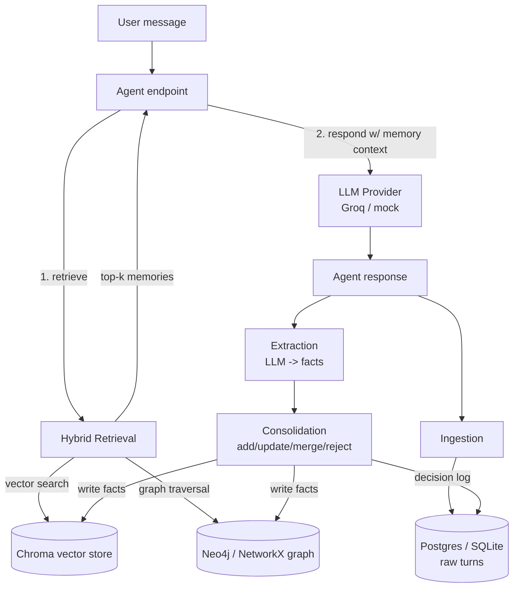

# AgentMemory — A Long-Term Memory Layer for Conversational AI Agents

> Inspired by the Mem0 approach ([arXiv:2504.19413](https://arxiv.org/abs/2504.19413)).

AgentMemory gives LLM-based agents **long-term, evolving memory** across
conversations. It extracts facts from dialogue, **consolidates** them
intelligently (update / merge / resolve conflicts instead of blindly
appending), stores them in a **graph + vector** structure, and retrieves the
most relevant memories for future queries.

It ships with an **evaluation harness** that compares three configurations:
no memory, naive vector-only memory, and the full graph + consolidation system.

---

## Why this is interesting

A naive memory just dumps every fact into a vector store. Ask it where the user
lives after they've moved twice and it returns three contradictory answers.
AgentMemory instead *reconciles* new facts against existing ones:

```
turn 1: "I live in Delhi."        -> ADDED    user lives_in Delhi
turn 8: "I moved to Bangalore."   -> UPDATED  user lives_in Delhi -> Bangalore
turn 9: "Actually, Bengaluru."    -> MERGED   (same place, canonical spelling)
```

Every decision is logged, so retrieval stays clean and the eval harness can
count how many duplicate/conflicting facts each approach accumulates.

---

## Architecture



**Pipeline stages** (each is its own package under `app/`):
`ingestion → extraction → consolidation → storage (graph + vector) → retrieval → agent → eval`.

---

## Everything is free to run

- **LLM:** Groq free tier (Llama 3.1 / 3.3), or a built-in **mock** provider for
  zero-cost, offline runs and tests.
- **Embeddings:** local `sentence-transformers` (`all-MiniLM-L6-v2`) — no API cost.
- **Graph:** Neo4j Community (Docker) or in-process **NetworkX** (zero infra).
- **Vector store:** Chroma (embedded, on-disk).
- **Relational:** Postgres (Docker) or local **SQLite** fallback.

You can run the entire pipeline and test suite with **no API key and no Docker**
by keeping the defaults (`LLM_PROVIDER=mock`, `GRAPH_PROVIDER=networkx`).

---

## Setup

### 1. Get a free Groq API key (optional — only for real LLM output)

1. Sign up at <https://console.groq.com>.
2. Go to **API Keys → Create API Key**.
3. Copy the key.

### 2. Configure environment

```bash
cp .env.example .env
# For real LLM output, set in .env:
#   LLM_PROVIDER=groq
#   GROQ_API_KEY=your_key_here
# To run free/offline, leave LLM_PROVIDER=mock (the default).
```

### 3a. Run locally (no Docker, no cost)

```bash
python -m venv .venv && source .venv/bin/activate
pip install -r requirements.txt
uvicorn app.api.main:app --reload
# -> http://localhost:8000/health   and   http://localhost:8000/docs
```

### 3b. Run the full stack with Docker (Postgres + Neo4j + app)

```bash
docker compose up --build
```

---

## Example usage

Full interactive docs are at `http://localhost:8000/docs`. The main endpoints:

**Chat (memory-augmented agent):** retrieves memories, replies, then learns from the turn.

```bash
# Teach the agent something
curl -X POST localhost:8000/chat -H 'content-type: application/json' \
  -d '{"session_id":"demo","message":"I just moved to Bangalore and I love hiking."}'

# Ask about it later — the answer uses retrieved memory
curl -X POST localhost:8000/chat -H 'content-type: application/json' \
  -d '{"session_id":"demo","message":"Where do I live?"}'
```

The chat response includes `memories_used` (what was retrieved) and
`facts_learned` (how many facts the turn produced).

**Ingest (store a raw turn without the agent):**

```bash
curl -X POST localhost:8000/ingest -H 'content-type: application/json' \
  -d '{"session_id":"demo","user_message":"hi","agent_response":"hello"}'
curl localhost:8000/ingest/demo   # list stored turns
```

---

## Evaluation

Compare no-memory / naive-vector / full-AgentMemory on a synthetic
multi-session dataset (updates, conflicts, corrections):

```bash
python -m app.eval.run
```

This prints a comparison table, saves a chart to `app/eval/outputs/comparison.png`,
and writes `results.md`. Runs in mock mode with zero API cost; set
`LLM_PROVIDER=groq` for real LLM scoring.

---

## Tests

```bash
pytest
```

The suite runs fully in mock mode — no API calls, no external services.

---

## Project structure

```
app/
  core/           config (pydantic-settings), domain models, logging
  llm/            LLM provider interface + Groq + mock + factory
  embeddings/     embedding interface + local (sentence-transformers) + mock
  ingestion/      SQLAlchemy models, repository, ingest service
  extraction/     prompt + robust JSON parser + FactExtractor
  consolidation/  ConsolidationEngine (add / update / merge / reject)  <-- core piece
  storage/        graph (Neo4j / NetworkX) + vector (Chroma) + composite store
  retrieval/      HybridRetriever (vector + graph traversal, ranked, budgeted)
  agent/          MemoryAgent orchestrator (retrieve -> respond -> learn)
  eval/           synthetic dataset, LLM-as-judge, three configs, harness, runner
  api/            FastAPI app, request/response schemas, routes
tests/            unit + API tests (extraction, consolidation, retrieval, api)
```

Every provider (LLM, embeddings, graph, vector, relational) sits behind an
interface with a factory, so backends swap via `.env` with no code changes.
