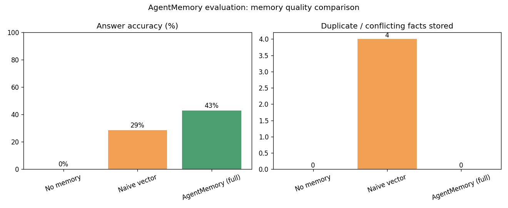

# AgentMemory — Evaluation Results

_Run configuration: LLM=`mock`, embeddings=`mock`._

This harness compares three memory strategies on a synthetic multi-session dataset that deliberately includes **updates, conflicts and corrections** (e.g. the user moves city, changes job, switches favorite food). The correct answer to each probe depends on the *latest* consolidated state.

## Comparison table

| Configuration      | Accuracy   | Correct/Total   |   Avg retrieval (ms) |   Build time (s) |   Duplicate facts |
|--------------------|------------|-----------------|----------------------|------------------|-------------------|
| No memory          | 0%         | 0/7             |                 0    |            0     |                 0 |
| Naive vector       | 29%        | 2/7             |                 0.08 |            0.003 |                 4 |
| AgentMemory (full) | 43%        | 3/7             |                 0.04 |            0.001 |                 0 |

## Chart

## Metrics explained

- **Accuracy** — fraction of QA probes graded correct by an LLM-as-judge.
- **Avg retrieval (ms)** — mean time to fetch memories for a query (0 for the no-memory baseline, which retrieves nothing).
- **Build time (s)** — total time to construct memory from all conversations.
- **Duplicate facts** — facts stored beyond the number of distinct (entity, attribute) slots; a proxy for redundant/conflicting memory.

## Takeaways

- The **no-memory** baseline cannot answer questions about the user and scores lowest — it has no way to recall prior sessions.
- **Naive vector memory** stores every extracted fact without reconciliation, so it accumulates **4 duplicate/conflicting fact(s)**. Stale values (old city, old job) linger and can be retrieved alongside the correct ones.
- **AgentMemory (full)** consolidates facts (update/merge/reject), keeping **0 duplicate fact(s)** and preserving the correct latest state — achieving **43%** accuracy.

**Best configuration: AgentMemory (full) (43% accuracy).**

> Note: run in mock mode these numbers are deterministic and illustrate the _mechanism_. With `LLM_PROVIDER=groq` and local embeddings the absolute accuracies rise, but the ordering (full > naive > none) holds because consolidation is what removes stale/conflicting memories.
